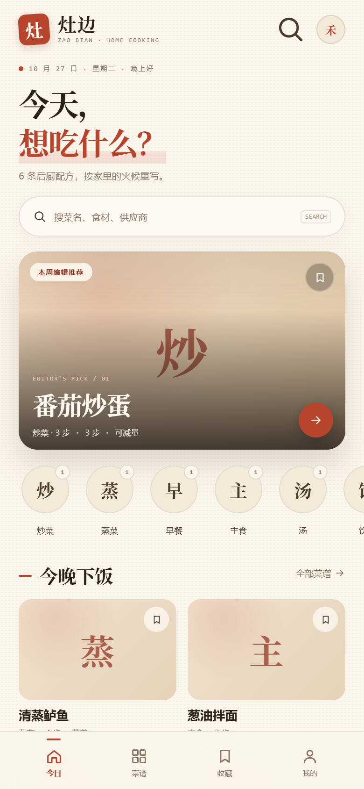

# 灶边 · Zaobian

一个离线、可点击、可打包成 Android APK 的菜谱 App 原型。

「灶边」把后厨配方重新排成家庭厨房能读的节奏：先决定今晚吃什么，再看份量、备料、步骤，最后进灶台模式。界面用米纸底色、朱砂红和墨绿档案卡，中文标题使用衬线字体；做菜页切换到深色高对比模式。



**[下载 v0.1.0 demo APK](https://github.com/star17965/zaobian/releases/latest)**（约 510 KB，Android 6.0+，6 条原创示例配方）

> 当前仓库是**代码 + 6 条原创 demo 数据**。完整 340 条 CookLikeHOC 数据和图片没有包含在仓库里，原因见 [NOTICE.md](NOTICE.md)。

## 功能

- **今日**：编辑推荐 hero、6 个高频分类、今晚下饭卡片、数据说明。
- **菜谱库**：搜索菜名 / 食材 / 供应商，分类筛选，列表降级占位。
- **详情**：原方 / 半份 / 1/3 份切换，备料勾选，步骤计时，营养与来源档案卡。
- **做菜**：深色灶台模式，大字号步骤，上一步 / 下一步，计时器，完成页。
- **收藏 / 我的**：`localStorage` 收藏持久化，数据统计和口径说明。
- **Android 壳**：WebView，竖屏，奶油色状态栏 / 导航栏，返回键接管，震动，屏幕常亮，系统分享。
- **离线**：无网络请求；图片、数据、字体均可本地打包。

份量换算只处理 `g` / `ml`，不会改温度和时间；缺失的营养、图片和步骤都有明确的空状态，不把“未收录”当成 0。

## 本地预览

直接打开：

```text
www/index.html
```

这是纯静态页面，没有构建步骤；`file://` 下也能运行，因为数据是 `window.APP_DATA`，不是 `fetch()`。

## 构建 APK

需要：

- JDK 17
- Android SDK Platform 34
- Android SDK Build-Tools 34.0.0
- Python 3.10+（只用于把 `classes.dex` 装进 APK）

设置环境变量：

```powershell
$env:JAVA_HOME = "C:\path\to\jdk17"
$env:ANDROID_SDK_ROOT = "C:\path\to\android-sdk"
```

构建：

```powershell
powershell -ExecutionPolicy Bypass -File .\android\build.ps1
```

如果 `python` 不在 PATH，可以显式传入：

```powershell
.\android\build.ps1 -Python "C:\path\to\python.exe"
```

首次构建会在 `android/keystore/` 生成一个本地签名密钥和随机密码；该目录已被 `.gitignore` 忽略。产物在 `dist/zaobian-v0.1.0.apk`。

## 目录

```text
www/                前端：index.html / css / js / fonts
android/            Android WebView 壳、资源、构建脚本
docs/               截图、数据格式说明
```

## 数据

`www/js/data.js` 是 6 条原创 demo 配方，覆盖炒菜、蒸菜、早餐、主食、汤、饮品，并包含：

- 有步骤 / 无步骤两种状态
- 有营养 / 无营养两种状态
- 有份量 / 无份量两种状态

字段说明见 [docs/data-schema.md](docs/data-schema.md)。换成自己的 `APP_DATA` 即可复用整套 UI。

### 关于完整 CookLikeHOC 数据

上游 [Gar-b-age/CookLikeHOC](https://github.com/Gar-b-age/CookLikeHOC) 没有 LICENSE 文件。为了避免把没有明确授权的内容再次分发，这个仓库只保留代码和原创 demo 数据。若要使用上游的 340 条配方和图片，请先取得上游作者许可，并遵守其条款。

## 字体

`www/fonts/` 内置 Noto Serif SC 子集（SIL OFL 1.1），用于 Android WebView 的中文衬线标题。许可信息在 `www/fonts/NOTICE.txt`。

## License

代码和 6 条 demo 数据采用 [MIT License](LICENSE)。第三方内容的归属与限制见 [NOTICE.md](NOTICE.md)。